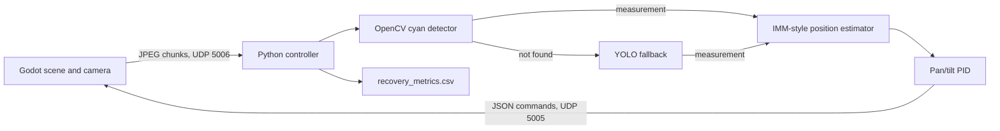

# Project Report: FSOC Virtual Tracking

**Snapshot date:** 2026-09-29

## Overview

This project is a Godot 4.7 3D simulation paired with a Python computer-vision controller. A cyan beacon moves in the scene; a camera mounted on a simulated drone streams frames to Python. Python detects the beacon, estimates its image position, calculates pan/tilt commands, and sends them back to Godot over UDP.

The intended fast path is OpenCV color detection. YOLO is called only when OpenCV does not return a detection. The live controller uses one estimator and one PID control path for either source.

## Data Flow



Godot captures the active viewport, resizes it to 640 x 480, JPEG-encodes it, and sends small UDP chunks at a configured 30 FPS. Python reassembles frames and sends pan/tilt velocity commands as JSON. Godot applies those velocities to the gimbal and stops motion if commands become stale for 0.5 seconds.

## Godot Scene

The main scene is [main.tscn](main.tscn), configured in [project.godot](project.godot).

- `target platformA/beacon` is a cyan emissive sphere. Its configured trajectory mode is `RANDOM`.
- `HostPlatformB` is the moving platform carrying `drone1`.
- `drone1` is a stationary `CharacterBody3D` with a gimbal, current camera, and visual laser beam pointing toward the beacon.
- `network_manager.gd` streams frames and receives Python commands. It is the network manager referenced by the scene; `network_manager duplicate.gd` is not.
- `beacon_detector.gd` has a Godot-side cyan-pixel detector, frame-displacement measurements, and periodic detection metrics. Its local gimbal control defaults off so Python can control the gimbal. Pressing `T` applies a 5-degree pan disturbance.
- `gimbal.gd` also contains an automatic target-following mode, but its configured default mode is `LOCAL_DETECTOR`; Python control is applied through the network manager.

## Python Tracking Pipeline

Run entrypoints are [main.py](main.py) and [godot_main.py](godot_main.py); both execute [python_controller.py](python_controller.py). The controller receives frames on UDP port `5006` and sends commands to port `5005` on `127.0.0.1`.

1. `detection/opencv_fast.py` thresholds a cyan HSV range, cleans the mask, and returns the largest qualifying contour center. This is the active primary detector.
2. If OpenCV has no detection, `detection/ai_verifier.py` runs YOLO and selects a candidate using confidence and proximity to frame center. Accepted detections pass through `tracking/target_validator.py`.
3. `tracking/imm_kalman.py` estimates image position and velocity. The current implementation is a lightweight fixed-weight blend of two transition models, rather than a full probabilistic IMM with per-model state and mode probabilities.
4. `control/pid_controller.py` converts image error to angular error and PID outputs to pan/tilt angular velocities. Current proportional gains are `0.8`, outputs are capped at `0.7 rad/s`, and a 3-pixel deadband is applied. The error sign is inverted for the Godot gimbal axes.
5. `geometry/godot_geometry.py` provides image center and pixel-to-angle helpers. Its field-of-view assumption is fixed at 1.2 radians.
6. `output/web_dashboard.py` serves a localhost-only browser dashboard, live JSON telemetry, and the latest annotated JPEG frame.
7. The Python loop also displays the annotated camera feed and appends completed disturbance-recovery measurements to `recovery_metrics.csv`.

## Other Python Modules

- `detection/ai_recovery.py` contains a separate AI recovery helper, with candidate scoring and an attempt limit. It is not called by the live controller.
- `tracking/roi_manager.py` and `tracking/reacquisition.py` provide ROI and bounded retry helpers. They are initialized/imported by the live controller but are not used in its current frame-processing path; current YOLO calls use the full frame.
- `output/godot_bridge.py` is an alternate bridge implementation. The live controller uses its own socket and packet handling instead.
- `web/index.html` is the live LAKSHYA dashboard. It shows the camera frame, detection source/confidence, processing FPS, image and angular errors, pan/tilt commands, error history, and system/recovery events. It reads controller data from `/api/state` and `/api/frame.jpg`; the uploaded-video simulation from the source demo is not used.
- Tests live under `tests/` and cover helper behavior, not a complete automated Godot/Python session.

## Run Instructions

Start the Godot project, then from PowerShell run:

```powershell
cd D:\fsoc-virtual-tracking
.\.venv\Scripts\python.exe main.py
```

The Python controller opens an OpenCV camera window. Press `Q` in that window or Ctrl+C in the terminal to stop it. Godot's `T` key applies the disturbance used to observe recovery.

While the controller is running, open the live dashboard at [http://127.0.0.1:8000/](http://127.0.0.1:8000/). The server binds to localhost only and shuts down with the Python controller.

The project-local environment currently has Python 3.11.3, OpenCV 5.0.0, NumPy 2.4.6, and Ultralytics 8.4.165. There is no dependency lock or requirements file in the repository, so the `.venv` is currently the recorded working environment.

## Validation and Recorded Results

- The live Godot/Python UDP loop has been run: the controller received frames, OpenCV detections were observed, and commands were sent to the gimbal.
- The focused Python recovery and ROI test run passed: 5 tests.
- The dashboard/recovery test run passed: 6 tests.
- Live endpoint checks returned HTTP 200 for the dashboard, state JSON, and JPEG frame. At validation time Godot and Python were connected and OpenCV was tracking.
- Python compile validation passed for the controller and entrypoints.
- `recovery_metrics.csv` contains 9 saved recovery samples, ranging from 1.609 to 8.325 seconds, with a mean of 3.832 seconds. These are previous simulation measurements, not a controlled benchmark.

## Known Limitations

- `models/yolov8n.pt` is the generic pretrained 80-class COCO checkpoint, not a beacon-trained model. The AI code does not filter predictions to a beacon class, and live fallback detections were inconsistent. Reliable AI reacquisition therefore still requires suitable trained weights and validation.
- ROI cropping and bounded retry helpers are not connected to the current live fallback path.
- The estimator is a simplified IMM-style filter. Camera field of view is hard-coded, and the same FOV value is used for both axes; camera/gimbal calibration remains necessary.
- Godot's separate `user://tracking_metrics.csv` logger currently writes `max_error` into both the `mean_error` and `max_error` columns. Python's `recovery_metrics.csv` is a different file and records recovery events.
- Existing tests do not exercise frame packet reassembly, real YOLO detections, or the complete closed loop automatically.
