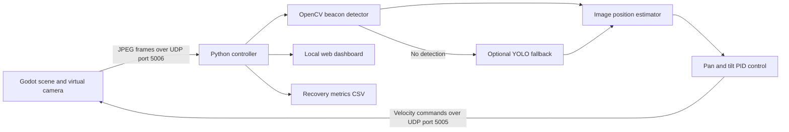

# LAKSHYA: Virtual Camera Tracking for Mobile FSOC Terminals

LAKSHYA is a software prototype for coarse pointing, acquisition, and tracking (PAT) in a simulated mobile free-space optical communication (FSOC) terminal. It combines a Godot 4 scene with a Python computer-vision and control loop.

## Overview

Godot streams 640 x 480 JPEG camera frames to Python over UDP. Python detects a cyan beacon with OpenCV, estimates its image position, and sends pan/tilt velocity commands back to the simulated gimbal. A YOLO detector is implemented as a fallback when the OpenCV detector loses the target.

The Python controller also serves a live browser dashboard and records recovery measurements in `recovery_metrics.csv` while running. The CSV is generated output and is excluded from Git.

## Architecture



See [the architecture notes](docs/architecture.md) and [the project report](PROJECT_REPORT.md) for implementation details and known issues.

## Components

- `main.tscn` and the Godot scripts implement the simulation, camera stream, and gimbal command handling.
- `python_controller.py` receives frames, runs detection and tracking, calculates control commands, and serves the dashboard.
- `detection/`, `tracking/`, `geometry/`, and `control/` contain the Python perception, estimation, coordinate, and PID helpers.
- `output/` contains the UDP bridge and dashboard server; it is source code and is intentionally not ignored.
- `web/index.html` is the dashboard UI. It is served by the running Python controller and uses its local API; opening the HTML file by itself does not provide live telemetry.
- `models/yolov8n.pt` is the included generic pretrained model used by the optional fallback. It is approximately 6.5 MB and is tracked as a regular file.

## Requirements

- Python 3.11
- Godot 4.x
- Python packages listed in `requirements.txt`

The YOLO fallback uses generic COCO weights, not a beacon-trained model, and has not been validated as a reliable beacon detector. The OpenCV detector is the primary path.

## Setup and Run

From PowerShell in the project directory:

```powershell
python -m venv .venv
.\.venv\Scripts\Activate.ps1
python -m pip install -r requirements.txt
```

Open the project in Godot, run the main scene, then start the Python controller in the activated environment:

```powershell
python main.py
```

`godot_main.py` is an alternate entry point to the same controller. The controller displays an OpenCV window; press `Q` there or Ctrl+C in the terminal to stop it. While it is running, the dashboard is available at [http://127.0.0.1:8000/](http://127.0.0.1:8000/).

Run the Python tests with:

```powershell
python -m pytest
```

## Current Scope and Limitations

- The Godot/Python UDP closed loop, OpenCV detection path, dashboard endpoints, and focused Python tests have been exercised; this is not a hardware PAT implementation.
- The YOLO fallback uses generic pretrained weights and may not identify the beacon consistently.
- The estimator is a simplified IMM-style blend, not a full probabilistic interacting multiple-model filter.
- Camera field of view is fixed in code; camera and gimbal calibration remain necessary.
- The test suite does not automatically exercise the complete live Godot/Python session or validate real YOLO detections.
- No MP4 evaluation workflow is documented or exercised here. No separate demo executable, screenshot set, presentation, or PDF submission bundle is present; the project report is available as `PROJECT_REPORT.md`.

## Team

SIH 2026 project: LAKSHYA.