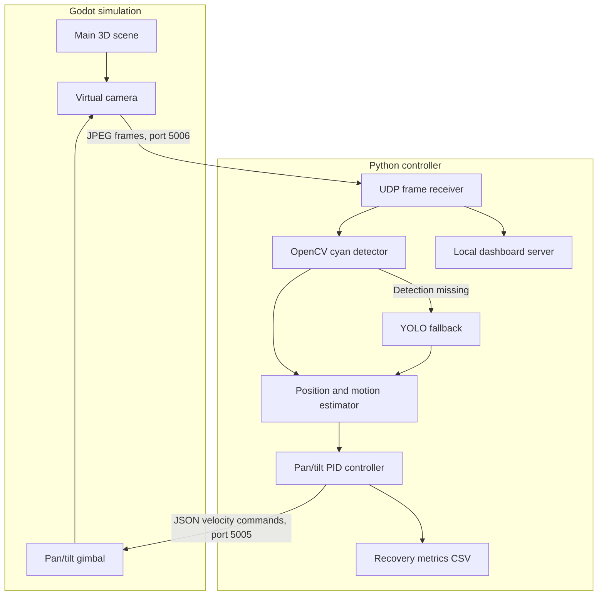

# System Architecture

The diagram describes the current closed-loop simulation path. UDP port `5006` carries camera frames from Godot to Python; UDP port `5005` carries pan/tilt velocity commands back to Godot.

The live controller is implemented in `python_controller.py`. The project report documents which helpers are active and which are currently unused.